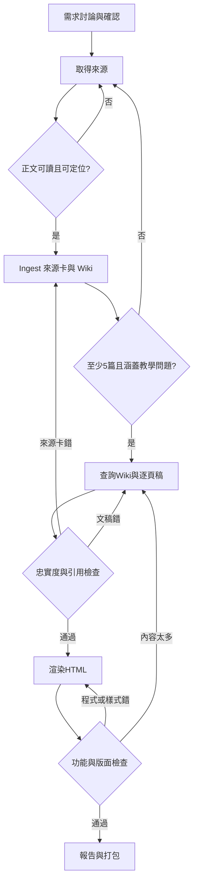

# Graph 與局部 Loop

本次是由 AI 依明確關卡執行的檔案式 workflow prototype，不是已部署的自動排程服務。

| 節點 | 輸入 | 輸出 | 檢查與退回 |
|---|---|---|---|
| 取得來源 | 教學問題 | raw/manifest.json、來源卡 | 不以搜尋標題代替正文；失敗換同文鏡像或來源 |
| Ingest | 原文定位 | wiki/sources、concepts、cases | 區分事實、推論、原創；有缺漏回來源 |
| 查詢與文稿 | Wiki | process/slides.json、對應表 | 每頁引用存在，研究保留限制；不通過只改對應頁 |
| 渲染 | 逐頁稿 | deck.html | 不增加來源外的事實 |
| 驗證 | 成品與來源 | checks/、執行報告 | 測九種配對、重設、換頁、內部連結與版面 |
| 打包 | 通過的檔案 | ZIP | 排除暫存與未公開全文 |

## Loop 規格
觸發：需求確認，或一個節點收到檢查失敗。
目標：可離線使用且有來源對應的 15 頁教學簡報。
限制：不捏造來源或玩家測試；最多修 3 輪；沒有證據不硬補。
完成：來源、文稿與功能驗收通過，或將未解決項明確標出。
停止：資料不足且無替代、三輪仍未通過，交代阻塞而不宣稱完成。

## 檢查前移
初始構想是取得資料後直接 ingest，再於文稿時查引用。實際遇到空正文與 PDF 讀取錯誤後，在 ingest 前增加「正文可讀＋原文定位」關卡。研究摘要也先記錄指標與限制，防止到排版後才發現過度推論。

## 審查界線
本次內容審查由同一個 AI 對照原文進行，沒有另外開啟獨立審查對話。自動測試只能驗證結構與功能，不能證明教學效果。交件前使用者仍應試玩與閱讀來源。
